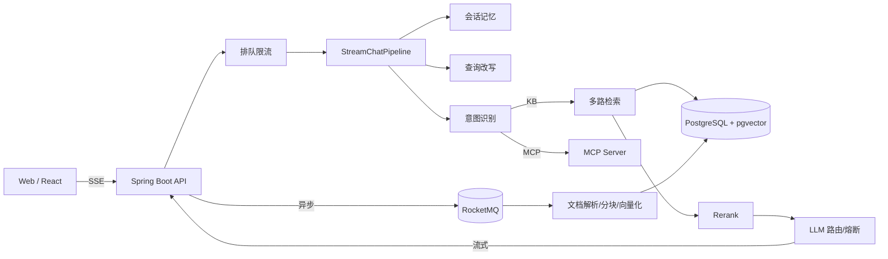

# SageRAG

> 一个可本地部署的通用知识库智能问答平台：文档入库 → 多路检索 → 意图路由 → 流式回答 → 引用溯源。

SageRAG 面向「把一堆内部文档变成可追问的知识库」这个场景，覆盖了从文档上传、解析、分块、向量化，到意图识别、混合检索、Rerank、SSE 流式生成、会话记忆和链路追踪的完整链路。项目以单体后端 + 独立前端 + 独立 MCP Server 的方式组织，适合本地开发、二次开发和面试演示。

## 功能特性

- **流式问答**：SSE 逐字输出，支持中断、重试、深度思考内容单独展示。
- **多路检索**：意图定向检索 + 全局向量检索并行召回，统一去重后交给 Rerank。
- **意图路由**：三级意图树（领域 → 分类 → 主题），叶子节点绑定知识库或 MCP 工具，支持后台可视化维护。
- **文档入库**：支持本地文件 / 远程 URL，Tika 解析 + 参数化分块（固定大小 / 结构感知），RocketMQ 异步处理，分块日志可观测。
- **会话记忆**：保留最近 N 轮对话，超出阈值后异步生成摘要，控制上下文长度。
- **模型容错**：多模型候选按优先级路由，单模型三态熔断（CLOSED / OPEN / HALF_OPEN），失败自动降级。
- **流量保护**：Redis 公平排队 + 分布式信号量，避免突发请求压垮模型服务。
- **MCP 工具调用**：独立 `mcp-server` 进程，内置销售汇总、工单查询、天气查询 3 个演示工具；后端按工具 Schema 做参数抽取后调用。
- **可观测性**：`@RagTraceNode` 记录一次问答的每个阶段，后台可查看耗时与错误。
- **离线评测**：提供脚本批量跑问题集，统计命中率与耗时。

## 技术架构



一次提问的主链路：

1. `ChatQueueLimiter` 获取排队令牌；
2. `StreamChatPipeline` 加载会话记忆、改写/拆分问题；
3. 意图分类器对子问题并行打分，过滤低置信度意图；
4. 知识库意图走多通道检索，MCP 意图走工具调用；
5. 组装 `system + history + evidence + question` 提示词；
6. `LLMService.streamChat` 逐块输出，前端渲染引用；
7. 全过程写入 Trace 表，后台可回放。

## 技术栈

| 层次 | 选型 |
|---|---|
| 后端 | Java 17、Spring Boot 3.5、MyBatis-Plus、Sa-Token |
| 存储 | PostgreSQL 16 + pgvector、Redis、RocketMQ |
| 模型接入 | 百炼 / 硅基流动 / Ollama，统一 OpenAI 风格适配 |
| 文档处理 | Apache Tika、自定义分块策略 |
| 工具协议 | MCP Java SDK（独立 Server 进程） |
| 前端 | React 18、TypeScript、Vite、Tailwind CSS、shadcn/ui、Zustand |
| 部署 | Docker Compose |

## 快速开始

### 1. 启动基础设施

```bash
docker compose up -d postgres redis rocketmq-namesrv rocketmq-broker
```

首次启动会自动建表并写入管理员账号、两个演示知识库和示例问题。

> 修改 SQL 后需要重建空库：`docker compose down -v` 再启动。

### 2. 配置模型

```bash
cp .env.example .env
```

至少配置一个 chat 模型和一个 embedding 模型：

```properties
BAILIAN_API_KEY=sk-xxx          # 百炼：chat + embedding + rerank
# 或
SILICONFLOW_API_KEY=sk-xxx      # 硅基流动：chat + embedding
```

也可以使用本地 Ollama，把 `ai.chat.candidates` 中的本地模型放在 priority 1。

### 3. 启动后端

```bash
mvn -o install -DskipTests                       # 首次构建，把 framework / infra-ai 装进本地仓库
java -jar bootstrap/target/bootstrap-0.0.1-SNAPSHOT.jar
```

或直接运行 `.\scripts\start-backend.ps1`。服务地址：`http://localhost:9090/api/sagerag`。

### 4. 启动 MCP Server（可选）

```bash
.\scripts\start-mcp.ps1                          # http://localhost:9099
```

### 5. 启动前端

```bash
.\scripts\start-frontend.ps1                     # http://localhost:5173
```

默认账号：`admin / admin`。

### 6. 导入演示文档

进入后台 → 知识库管理 → 选择「员工手册与制度」或「业务系统手册」→ 上传
`resources/demo-docs/` 下的 Markdown → 点击「分块」。

回到聊天页，用示例问题提问即可看到检索、引用和流式回答。

## 目录结构

```text
SageRAG
├── bootstrap          # 主应用：问答、检索、意图、知识库、后台
├── framework          # 横切能力：异常、SSE、上下文、幂等、Trace、MQ
├── infra-ai           # 模型供应商抽象：chat / embedding / rerank 路由与熔断
├── mcp-server         # 独立 MCP Server（工具提供方）
├── frontend           # React 管理后台 + 聊天页
├── resources
│   ├── database       # 建表与初始化 SQL
│   ├── demo-docs      # 演示文档
│   └── prompt         # 提示词模板
├── eval               # 离线评测脚本与问题集
└── docker-compose.yml
```

## 核心设计

### 为什么只用 pgvector

知识库规模在百万级 chunk 以内时，pgvector 的 HNSW 索引足够用；把向量和业务数据放在同一个 PostgreSQL 里，可以直接做事务、备份和权限管理，少维护一套 Milvus。检索层保留了 `RetrieverService` / `VectorStoreService` 抽象，后续要换向量库只需要新增实现。

### 为什么入库不再用可视化 Pipeline

原方案把「抓取 → 解析 → 清洗 → 分块 → 索引」做成数据库里可编排的节点链，灵活但概念重、配置复杂。SageRAG 改为**参数化分块**：文档只带 `chunkStrategy` + `chunkConfig`，由策略工厂创建对应的 `ChunkingStrategy`。少一层编排，链路更容易解释和排错，也方便按知识库调整参数。

### 文件存储抽象

`FileStorageService` 默认落本地磁盘（`./data/uploads`），通过 `rag.storage.type` 切换 S3 兼容存储。单机部署不依赖对象存储，多实例部署时再启用 S3。

### 异步入库

上传只负责落库和发消息，RocketMQ 消费端执行解析、分块、embedding 和向量写入，失败可重试；分块日志记录各阶段耗时，前端能直接看到慢在哪一步。

### 稳定性

- 公平排队：按到达顺序分配并发令牌，避免大请求饿死小请求；
- 熔断降级：每个模型独立统计失败次数，打开后自动切到下一个候选；
- 检索降级：某个通道异常只记日志，不影响其他通道返回结果。

## 配置说明

默认模型（可在 `application.yaml` 的 `ai.*.candidates` 中调整）：

| 能力 | 模型 | 说明 |
|---|---|---|
| Chat | `qwen3.8-max-0902` | 普通问答关闭思考模式，首字延迟约 5–7s；开启深度思考后走 reasoning |
| Embedding | `qwen3.7-text-embedding-flash` | 输出 1024 维，对应 `t_knowledge_vector.embedding vector(1024)` |
| Rerank | `qwen3.7-text-rerank` | 百炼原生 rerank 接口 |

> 换 embedding 模型时必须同时改 `EMBEDDING_DIMENSION` 和向量表维度，否则写入会失败。

| 配置 | 说明 |
|---|---|
| `POSTGRES_*` / `REDIS_*` | 数据库与缓存连接 |
| `ROCKETMQ_NAME_SERVER` | RocketMQ NameServer 地址 |
| `BAILIAN_API_KEY` / `SILICONFLOW_API_KEY` | 模型服务 Key |
| `STORAGE_TYPE` | `local` 或 `s3` |
| `EMBEDDING_DIMENSION` | 向量维度，必须与 embedding 模型一致 |
| `rag.search.channels.*` | 检索通道阈值与召回倍数 |
| `rag.rate-limit.global.*` | 全局并发与排队参数 |
| `rag.memory.*` | 会话保留轮数与摘要阈值 |

## 离线评测

```bash
python eval/run_eval.py --base-url http://localhost:9090/api/sagerag --questions eval/questions.jsonl
```

脚本会逐条调用问答接口，统计关键词命中、平均首字延迟和总耗时，输出 Markdown 报告。详见 `eval/README.md`。

本机示例数据实测（qwen3.8-max-0902 + qwen3.7-text-embedding-flash + qwen3.7-text-rerank）：

```text
6 条问题：命中 6/6
平均首字延迟：约 6.1s
平均总耗时：约 8.5s
```

